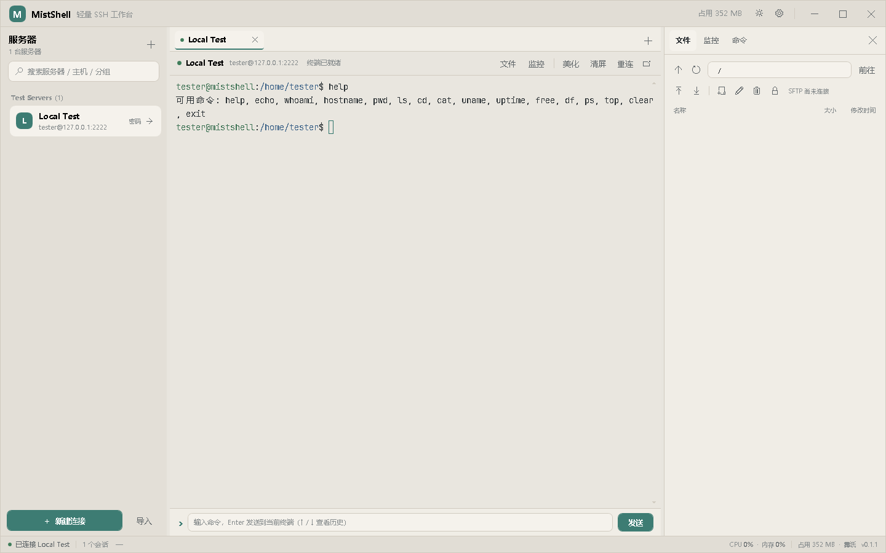
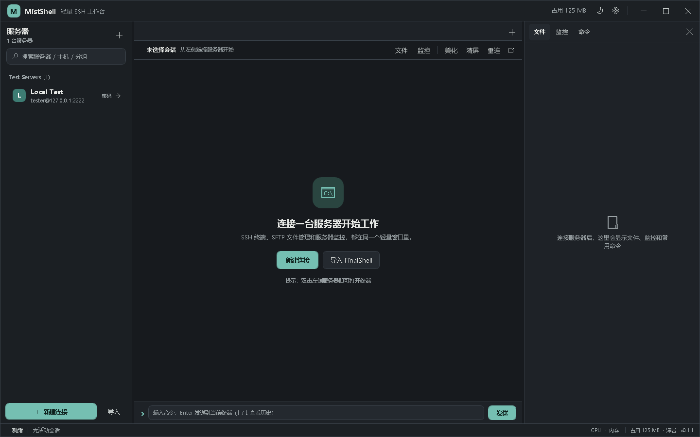

# MistShell

轻量、护眼的 Windows SSH / SFTP 工作台，定位是 FinalShell 的同类替代品。首版重点解决两个问题：

1. **浅色主题不刺眼**：默认“雾纸”主题使用暖灰背景，不使用大面积纯白；另有“暖砂”和“深岩”深色主题。
2. **内存占用更低**：原生 .NET 9 / WPF 外壳，不运行 JVM，也不采用 Electron；所有终端标签共享一个 WebView2 渲染进程，并启用轻量单进程渲染模式。

> 当前版本：`v0.1.23`，Windows 10/11 x64。



## 已实现功能

### 连接与安全

- 服务器分组、搜索、收藏、最近连接
- 密码登录、私钥登录、私钥口令
- 密码和私钥口令使用 Windows DPAPI 加密，仅当前 Windows 用户可解密
- 首次连接显示 SSH 主机密钥 SHA256 指纹，支持“仅本次信任”或“信任并保存”
- 已保存的主机指纹自动校验；指纹变化时再次警告

### SSH 终端

- 多标签会话，标签自动编号避免重名
- ANSI/VT 终端、256 色/真彩色、UTF-8 中文
- 终端尺寸跟随窗口变化
- 终端字体可选：内置 JetBrains Mono、Cascadia Mono，另有 Cascadia Code、Consolas、Courier New、Lucida Console、微软雅黑
- 字体大小、行高可调；终端内 `Ctrl + 鼠标滚轮` 可直接缩放
- “美化”按钮一键发送 `LS_COLORS` / `ls --color` / zsh 高亮插件加载命令
- 复制、粘贴、全选、清屏；支持 `Ctrl+C` / `Ctrl+V`，设置里可查看完整快捷键
- 断线提示、一键重连
- 终端目录联动：执行 `cd` / `pushd` 后右侧文件面板自动跟随当前目录
- 快捷命令栏，支持 `Enter` 发送和 `↑` / `↓` 历史
- 常用命令片段，可新增、删除、双击发送

### SFTP

- 远程目录浏览、上一级、路径直达、刷新
- 上传：支持文件多选、文件夹递归上传、拖拽上传，完成后自动刷新远端目录
- 下载：支持 `Ctrl` / `Shift` 多选文件，支持文件夹递归下载到指定目录
- 传输队列、进度、状态、取消、清除已完成
- 新建文件夹、重命名、多选删除、修改八进制权限
- 双击文本文件打开远程编辑器，`Ctrl+S` 直接保存回服务器
- SFTP 连接与会话分开，终端和文件管理互不阻塞

### 服务器监控

- CPU、内存、Swap、磁盘、网络上下行
- 负载、运行时间、主机名、延迟
- 进程 CPU / 内存 Top 10
- 打开监控面板时才开始采集，关闭后停止，减少空闲开销

### 主题与界面

- 10 套低对比度主题：雾纸、暖砂、樱雾、冰川、青苔、深岩、午夜蓝、炭火、紫夜、石墨，另有跟随系统
- 设置中点选主题即时预览；标题栏主题按钮循环切换
- 深色主题下终端默认文字保持高对比度，不会出现“黑字看不清”
- 默认关闭模糊和重动画
- 可调终端字体、字号、行高、回滚行数
- 低内存模式：回滚缓冲限制为 2000 行，监控刷新间隔 5 秒
- 便携式数据目录：优先写在程序旁的 `data` 文件夹；不可写时回退到 `%LOCALAPPDATA%\MistShell`



## 快速开始

1. 解压 `MistShell-0.1.23-win-x64.zip`。
2. 运行 `MistShell.exe`。
3. 点击“新建连接”，填写主机、端口、用户名和密码/私钥。
4. 双击左侧服务器，或点击条目右侧的箭头即可连接。
5. 右侧面板：

| 标签 | 功能 |
|---|---|
| 文件 | SFTP 浏览、上传、下载、重命名、权限 |
| 监控 | CPU / 内存 / 磁盘 / 网络 / 进程 |
| 命令 | 常用命令片段 |

## 彩色 ls / zsh 高亮

终端本身支持 256 色和真彩色。`ls` 的文件类型颜色、zsh 语法高亮来自**远端 shell 配置**，不是终端模拟器自己画的。

MistShell 内置两种使用方式：

- 点击终端工具栏的“美化”按钮，发送一次 `LS_COLORS`、`ls --color=auto`、`grep --color=auto` 和 zsh 插件加载命令。
- 在右侧“命令”面板中双击“彩色 ls / zsh 高亮”，效果相同。

脚本会尝试加载远端已安装的：

- `zsh-syntax-highlighting`
- `zsh-autosuggestions`

如果没有安装，需要先在远端安装对应插件。想把配置永久保留，可以把脚本中的 `export`、`alias` 和 `source` 行放进服务器的 `~/.zshrc` 或 `~/.bashrc`。

## 主题

内置 10 套低对比度主题：

- 浅色：雾纸、暖砂、樱雾、冰川、青苔
- 深色：深岩、午夜蓝、炭火、紫夜、石墨

在“设置 → 外观主题”里点选主题会立即预览，点“保存设置”才正式保存；取消或关闭设置窗口会恢复原来的主题。也可以点击标题栏右侧的主题按钮循环切换。

## 远程文件编辑

在右侧文件列表双击文本文件，会打开远程编辑器：

- 修改后按 `Ctrl+S` 或点“保存”直接写回服务器
- 关闭未保存文件时会提示
- 支持 UTF-8 文本，最大 8 MB
- 二进制文件不支持直接编辑，请使用下载按钮

## SFTP 多选删除

文件列表支持 `Ctrl` / `Shift` 多选，选中多个文件或文件夹后点击删除按钮，会统一确认并删除。删除文件夹时会递归删除其内容。

## 监控

右侧“监控”面板的内存和磁盘卡片会在百分比下方显示实际容量，例如“已用 6.2 GB / 共 15.6 GB”。

## 分享安装包

点击左下角“分享”，选择保存位置，会生成一个无需携带本机数据的安装包：

- 安装到当前用户的 `%LOCALAPPDATA%\Programs\MistShell`
- 自动创建桌面快捷方式并启动 MistShell
- 不会打包 `data` 目录，因此不会包含服务器连接、密码、私钥、主机指纹、日志或下载文件
- 每台电脑首次启动都是干净配置，需要重新添加服务器

## SFTP 失败重试

传输队列中失败或被取消的文件/文件夹任务会显示“重试”按钮。点击后只重试该任务，保留原上传/下载来源路径，不需要重新选择文件；失败任务不会被“清除已完成”删除。

## 批量设置私钥

连接列表支持 `Ctrl` / `Shift` 多选。选中多台服务器后右键选择“批量设置私钥…”，可以为它们统一指定已保存私钥和私钥口令。

## 数据迁移与日志

新版本首次启动时会查找同目录下旧版 `MistShell-*` 文件夹；如果当前 `data` 没有连接数据，会自动迁移旧版的 `connections.json` 和 `settings.json`。日志超过 5 MB 会轮转，保留最近 3 个归档文件。

## SSH 私钥管理

在“新建连接 / 编辑连接 → 私钥”里点击“管理私钥…”：

- 私钥名称：例如 `local`
- 私钥内容：粘贴 OpenSSH / PEM / PPK 私钥，或点击“从文件导入”
- 保存后，连接编辑窗口会列出已保存私钥，选中即可使用
- 私钥内容使用 Windows DPAPI 加密，仅当前 Windows 用户可解密
- 仍支持原来的“私钥文件路径”方式

## 从 FinalShell 导入连接

点击左下角“导入”，选择：

- FinalShell 安装目录（例如 `G:\softwares\finalshell`），或
- 其下的 `conn` 目录
- 桌面上的 `servers` 导出目录

MistShell 会递归读取 `*_connect_config.json` 中的名称、主机、端口、用户名和描述：

- 根目录下的连接归入“连接”分组
- `servers\曹操传` 这样的子目录会按目录名建立对应分组
- 重复连接会按 `主机:端口:用户名` 跳过
- 导入完成后窗口会显示文件数、连接数和分组数

**注意**：FinalShell 的密码是它自己的加密格式，不能直接迁移。首次连接时 MistShell 会提示补全密码或私钥。

## 快捷键

在“设置 → 快捷键 → 查看快捷键”可以打开完整说明。当前快捷键为固定方案，暂不支持自定义绑定。

| 快捷键 | 功能 |
|---|---|
| `Enter` | 快捷命令栏发送；连接列表聚焦时连接 |
| `↑` / `↓` | 快捷命令历史 |
| `Ctrl+鼠标滚轮` | 在终端内快速调整字号 |
| `Ctrl+C` | 有选中内容时复制；没有选中时发送终端中断（^C） |
| `Ctrl+V` | 粘贴剪贴板内容 |
| `Ctrl+Insert` | 复制终端选中内容 |
| `Shift+Insert` | 粘贴 |
| `Ctrl+Shift+C` | 复制终端选中内容 |
| `Ctrl+Shift+V` | 粘贴 |
| `Ctrl+Shift+A` | 全选终端内容 |
| `Ctrl+Shift+L` | 清屏 |
| 鼠标右键 | 复制、粘贴、全选、清屏菜单 |
| 双击文件 | 下载 |
| 双击目录 | 进入目录 |

## 内存表现（本机实测）

测试环境：Windows 10 22H2 x64，同一台机器，任务管理器工作集口径，统计主进程和其 WebView2 子进程。

| 场景 | 总内存 |
|---|---:|
| MistShell 空闲，无会话 | 约 130 MB |
| MistShell 1 个 SSH 会话 | 约 300 MB |
| MistShell 5 个 SSH 会话 | 约 320–330 MB |
| FinalShell 4.5.12 启动后空闲 | 约 351 MB |

说明：

- MistShell 每个 SSH 会话的增量主要是 SSH 连接和终端缓冲，多个标签共享同一个 WebView2 渲染进程，因此 1 → 5 个会话的增量很小。
- 内存数据受系统版本、WebView2 版本、终端输出量和回滚设置影响，以上是本机实测值，不是理论值。
- 如果系统上 WebView2 使用了不同的进程策略，数值会变化。

## 数据与隐私

- 默认数据目录：`MistShell.exe` 同级的 `data` 文件夹。
- 如果程序目录不可写：`%LOCALAPPDATA%\MistShell`。
- 每个解压目录的 `data` 是独立的。升级到新解压目录时，把旧目录的 `data` 整个复制到新目录，可保留连接、密码、主机指纹和设置。
- 连接配置：`data\connections.json`
- 设置：`data\settings.json`
- 日志：`data\mistshell.log`
- 密码只有 DPAPI 密文，不保存明文。
- 不上传配置，不包含遥测。
- 迁移到另一台 Windows 机器时，DPAPI 密文无法解密，需要重新输入密码。

## 系统要求

- Windows 10 1809+ / Windows 11，x64
- Microsoft Edge WebView2 Runtime
  - Windows 10/11 通常已预装
  - 如未安装，请从 Microsoft 官网安装 Evergreen WebView2 Runtime
- 发布包为 self-contained，不要求安装 .NET 运行时

## 首版不包含

- SSH 跳板机、代理链
- 本地/远程端口转发
- 目录递归下载
- 内置代码编辑器
- 云同步 / 账号系统
- 手机端
- 插件系统

这些功能可以按后续版本迭代。

## 从源码构建

环境：.NET SDK 9.0、Windows 10/11 x64。

```powershell
# 还原、编译
dotnet build MistShell.sln -c Release

# 核心冒烟测试
dotnet run --project tools\SmokeTests\SmokeTests.csproj -c Release

# 发布 self-contained 版本
dotnet publish src\MistShell\MistShell.csproj `
  -c Release -r win-x64 --self-contained true `
  -p:PublishSingleFile=false -p:DebugType=None `
  -o dist\MistShell-0.1.23-win-x64
```

xUnit 测试在 `tests\MistShell.Tests`：

```powershell
dotnet test tests\MistShell.Tests\MistShell.Tests.csproj -c Release
```

> 个别受限的 Windows 沙箱环境会拒绝 VSTest 的 testhost 进程句柄；此时可以先运行 `tools\SmokeTests`，或在普通桌面环境运行 xUnit。

## 项目结构

```text
MistShell/
├─ src/MistShell/              WPF 主程序
│  ├─ Controls/                WebView2 终端宿主
│  ├─ Models/                  连接、设置、监控、传输模型
│  ├─ Services/                SSH、SFTP、DPAPI、主题、导入
│  ├─ ViewModels/              终端、SFTP、监控、主界面
│  ├─ Views/                   连接、设置、主机指纹、输入对话框
│  ├─ Assets/terminal/web/     本地 xterm.js 运行时
│  └─ Themes/                  主题样式
├─ tests/MistShell.Tests/      xUnit 测试
├─ tools/SmokeTests/           无测试运行器依赖的冒烟测试
├─ tools/test-ssh/             本地 ssh2 联调服务器（开发用）
└─ docs/                       截图
```

## 第三方组件

- [xterm.js](https://xtermjs.org/) — MIT
- [SSH.NET](https://github.com/sshnet/SSH.NET) — MIT
- [Microsoft.Web.WebView2](https://learn.microsoft.com/microsoft-edge/webview2/) — Microsoft 许可
- [ssh2](https://github.com/mscdex/ssh2)（仅开发测试服务器使用）— MIT

详见 `THIRD-PARTY-NOTICES.md`。

## License

MIT，详见 `LICENSE`。
